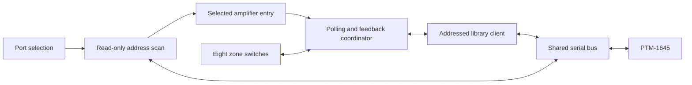

# ADA RS-232: Bronze submission review

This packet prepares a small first Home Assistant Core contribution for the
Audio Design Associates PTM-1645. It targets **Bronze only**. It does not change
the released HACS integration or submit anything upstream automatically.

## Read and review

- [Readable documentation preview](docs-preview.md)
- [Exact Core PR description](core-pr.md)
- [Exact documentation PR description](docs-pr.md)
- [Exact branding PR description](brands-pr.md)
- [Bronze rule audit and validation evidence](quality-review.md)

Code and assets:

- [Core integration and tests](https://github.com/home-assistant/core/compare/dev...RebbePod:add-ada-rs232)
- [Documentation source](https://github.com/home-assistant/home-assistant.io/compare/next...RebbePod:add-ada-rs232)
- [ADA branding](https://github.com/home-assistant/brands/compare/master...RebbePod:add-ada-rs232)
- [Published protocol library 0.2.0](https://pypi.org/project/ada-rs232/0.2.0/)
- [Matching library source and release](https://github.com/RebbePod/ada-rs232-python/releases/tag/v0.2.0)

## Reviewed revisions

- Core: [`a0050a00`](https://github.com/RebbePod/core/tree/a0050a0095b69034f844f9daceaae62c8b3d0147/homeassistant/components/ada_rs232), tested on upstream `cdba0080`.
- Core tests: [same revision](https://github.com/RebbePod/core/tree/a0050a0095b69034f844f9daceaae62c8b3d0147/tests/components/ada_rs232).
- Documentation: [`0885102`](https://github.com/RebbePod/home-assistant.io/blob/0885102bf773851961d5afdbd8d61b2accfd0ffc/source/_integrations/ada_rs232.markdown).
- Brand images: [`75d5a9d`](https://github.com/RebbePod/brands/tree/75d5a9dd3e3513ed44933ab19adee385cfa27a43/core_integrations/ada_rs232).

## First PR scope

- PTM-1645 only, with eight feedback-confirmed stereo-zone switches.
- Initial UI flow: select a serial port; a read-only scan selects a single
  available amplifier or offers the discovered addresses in a dropdown.
- One connection owner and command queue per port, shared by addressed entries
  and temporary configuration probes.
- Fixed 60-second polling, incoming feedback, translated communication errors,
  automatic reconnection, and cleanup on failed setup, unload, and shutdown.
- A public, typed, async protocol dependency. No protocol parser or local logo
  files are included in Core; the logos have their own companion change.

## How the initial code works

Each amplifier has its own entry and switches. Entries and temporary setup
scans use the same bus when their port matches. Releasing one entry keeps the
bus available to the others; the last owner closes it.

The contributor confirmed that zone control and automatic amplifier discovery
work on a physical PTM-1645 through ESPHome with HACS v0.2.1. The new Core wrapper
is covered by Home Assistant tests. Multiple physical daisy-chained amplifiers
have not been tested; the shared-connection behavior is tested with the library
boundary mocked.

## Kept for later PRs

Home Assistant's first-integration guide requires one platform and excludes
custom actions, diagnostics, options, and reconfiguration from the first PR.
Accordingly, this submission excludes:

- Output binary sensors and custom trigger mappings.
- Whole-chain/custom mask actions and hardware setup actions, including Quick
  Turn On, stored address changes, and trigger-default restoration.
- Diagnostics and reconfiguration.
- PTM-8100 model selection and four-zone support.

These capabilities remain in the HACS integration. A later Core actions change
must register its actions in `async_setup`, as required by the `action-setup`
rule, rather than copying HACS's entry-lifetime registration. User-configurable
polling will not be carried into Core. Hardware setup and PTM-8100 features need
additional physical validation before they are presented as hardware-tested.

## Readiness

The Core tests and prescribed repository checks are recorded in the
[quality review](quality-review.md). The declaration stays Bronze; the required
scorecard retains every rule key, with higher-tier work left for later.

All eight brand assets are prepared and locally validated. **Their upstream
availability remains pending** the companion brands PR and its merge. Bronze is
proposed for review, not awarded. The scorecard's brands entry records that merge
prerequisite explicitly.

Original PR templates and unchecked alternatives are preserved. Contributor
understanding/review attestations remain unchecked until you personally review
and understand the changes. Companion PR placeholders will be replaced with
actual links after approved submission.

## After your review

1. Confirm you have reviewed and understand the code, documentation, artwork,
   and exact PR descriptions, and approve submission.
2. Open the brands and documentation PRs, then the Core PR, and cross-link them.
3. Check upstream CI and complete the Contributor License Agreement if asked.
4. Respond to maintainer questions yourself with explanations you understand.

[Core's AGENTS.md](https://github.com/home-assistant/core/blob/dev/AGENTS.md)
requires that "a human must review, understand, and be able to explain every
change before it is submitted." This is also required by the
[Home Assistant AI policy](https://contributors.home-assistant.io/start/ai-policy/).

No upstream PRs, issues, or comments have been opened during preparation.
